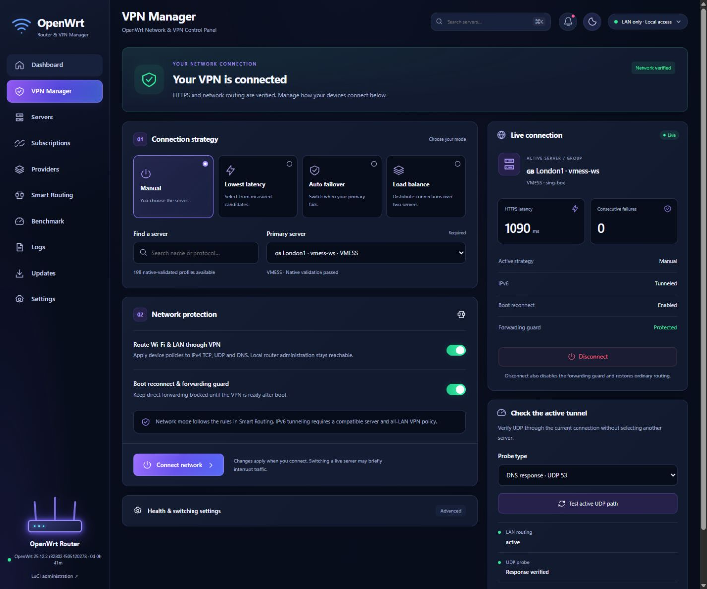

# 🌊 Gale Control

پنل مستقل و سبک مدیریت OpenWrt و VPN با رابط انگلیسی، طراحی موبایل، دادهٔ واقعی و مسیرهای بازیابی قابل بررسی.

[README کامل انگلیسی](README.md) · [راهنمای نصب کامل](docs/public/installation.md) · [امنیت و پشتیبان‌ها](SECURITY.md)

## ✨ امکانات

- داشبورد واقعی CPU/RAM/WAN، تاریخچهٔ تأخیر و رویدادهای بدون اطلاعات محرمانه
- اشتراک و User-Agent، کشف/استانداردسازی، حذف تکراری و اعتبارسنجی کانفیگ‌ها
- انتخاب دستی، کمترین تأخیر HTTPS، Failover و توزیع اتصال بین دو سرور
- سیاست IPv4 دستگاه‌ها، محافظ خروج مستقیم و IPv6 با سرویس‌دهندهٔ سازگار
- مدیریت نسخهٔ Xray و sing-box، ارتقای قابل بازگشت و پشتیبان کامل Gale
- رابط انگلیسی Dark/Light با فرم‌های مرتب و ناوبری شیشه‌ای موبایل

## 🚀 نصب هدایت‌شده

این نسخه برای پیکربندی آزمایش‌شده ارائه شده است: Google WiFi با ARMv7، OpenWrt25.12، fw4/nftables، رابط br-lan و آدرس LAN برابر192.168.10.1/24. نصب‌کننده برای اجبار سازگاری، شبکهٔ شما را تغییر نمی‌دهد. معماری و LANهای دیگر هنوز پشتیبانی نصب عمومی ندارند.

روی **رایانه** با Node22.12+، npm، Git، OpenSSH و tar و پس از آماده‌کردن احراز هویت SSH با کلید/agent:

```sh
git clone https://github.com/its-hesam/gale-control.git
cd gale-control
npm ci
npm run install:router -- --host root@192.168.10.1 --install-deps
```

سپس http://192.168.10.1/gale/ را باز کنید. نصب به‌تنهایی VPN یا مسیریابی را فعال نمی‌کند؛ وارد Core Manager شوید، نسخه‌های لازم هسته را آماده کنید، اشتراک خودتان را وارد و تست کنید و سپس در VPN Manager اتصال را اعمال کنید. LuCI و SSH حفظ می‌شوند.

بررسی فقط‌خواندنی:

```sh
npm run check:router -- --host root@192.168.10.1
```

پیش‌نیازها، مدیریت نسخه، اولین اتصال و بازیابی در [راهنمای کامل](docs/public/installation.md) آمده‌اند. نصب‌کنندهٔ source آماده است و preflight و مسیر ارتقای نسخه‌ای روی دستگاه بررسی شده‌اند؛ آزمون جداگانهٔ نصب روی روتر factory-reset انجام نشده است. ادعای نصب یک‌کلیکی روی همهٔ روترها نداریم.

## 🔌 پروتکل‌ها

VLESS، VMess، WireGuard، OpenVPN، Trojan، Shadowsocks، Hysteria2، TUIC، AnyTLS و SOCKS/HTTP در مسیرهای هسته/آداپتور موجودند. XHTTP، gRPC، REALITY و زنجیره‌های محدود native/Clash به ترکیب هسته و نسخه وابسته‌اند. **اعتبارسنجی بومی با اتصال واقعی برابر نیست**؛ جدول README انگلیسی، شواهد و محدودیت هر ترکیب را مشخص می‌کند. اتصال سرویس‌دهندهٔ OpenVPN و همهٔ پروتکل‌ها آزموده نشده‌اند.

## 🆚 مقایسه با PassWall

تمرکز Gale روی تجربهٔ مستقل و موبایل‌محور، شفافیت وضعیت واقعی و workflowهای انتشار و بازیابی است. PassWall/PassWall2 اکوسیستم جاافتادهٔ LuCI و بسته‌های OpenWrt دارند. مقایسهٔ کامل همراه منابع رسمی در README انگلیسی آمده است؛ بدون benchmark مشترک ادعای سرعت بیشتر، RAM کمتر یا امنیت بالاتر نداریم.

پروژه هیچ اشتراک، کلید خصوصی یا پشتیبان شخصی داخل مخزن ندارد. پشتیبان کامل امضا می‌شود ولی رمزگذاری نمی‌شود؛ آن و کلید بازیابی را خصوصی نگه دارید.



## 🆕 کنترل‌های جدید شبکه

- مسیریابی مستقل وای‌فای ۲٫۴ و ۵ گیگاهرتز: VPN، مستقیم یا مسدود.
- دریافت و به‌روزرسانی فهرست GeoIP ایران و عبور مستقیم مقصدهای آن با کلید روشن/خاموش.
- بررسی و نصب نسخهٔ برنامه از GitHub در تنظیمات، همراه اعتبارسنجی و بازگشت نسخه.
- نمایش وضعیت واقعی VPN با چراغ‌های روتر؛ امکان بازگرداندن رفتار قبلی چراغ‌ها.

[راهنمای مسیریابی](docs/public/smart-routing.md) · [به‌روزرسانی و چراغ‌ها](docs/public/application-updates.md)

این قابلیت تفکیک اینترنت دو باند است؛ هر دو همچنان عضو LAN مشترک هستند. قواعد ایران بر اساس IP مقصد هستند و شامل geosite یا تطبیق نام دامنه نیستند.

## 🧭 Providers، Benchmark و Core Manager

چهار مخزن عمومی معرفی‌شده، کاتالوگ رسمی OpenVPN سرفشارک، افزودن مخزن با شاخه/پوشهٔ دلخواه و وارد کردن خروجی حساب پروتون/سرفشارک در Providers در دسترس‌اند. تست انتخابی HTTPS، سرعت و UDP در Benchmark و مدیریت نسخهٔ هسته‌ها در Core Manager قرار دارند.

ورود خودکار با رمز اصلی حساب یا تولید خودکار WireGuard حساب پیاده نشده؛ برای آن‌ها از پنل رسمی سرویس و وارد کردن فایل استفاده می‌شود. IKEv2 و L2TP آداپتور اتصال ندارند و دریافت فایل آن‌ها به معنی پشتیبانی اتصال نیست.

[راهنمای Providers](docs/public/providers.md) · [راهنمای تست و هسته‌ها](docs/public/benchmark-core-manager.md)

## 🔑 نصب با رمز SSH

اگر ورود با کلید ممکن نباشد، نصب‌کننده خودکار رمز root را در ترمینال درخواست می‌کند. برای انتخاب مستقیم این حالت:

```powershell
npm run install:router -- --host root@192.168.10.1 --install-deps --password
```

رمز را در پیام جداگانهٔ ترمینال وارد کنید؛ کنار `--password` ننویسید. رمز ماسک می‌شود و در فایل، متغیر محیطی یا آرگومان فرمان ذخیره نمی‌شود. همان اتصال SSH برای کل نصب استفاده می‌شود. `--batch` مخصوص اجرای بدون سؤال با کلید است. تغییر کلید هویتی SSH روتر خطایی مستقل است و بدون بررسی هویت دستگاه نادیده گرفته نمی‌شود.

### ارتقای اختیاری Firmware هنگام نصب

از نسخهٔ 0.3.3، اگر روتر نسخهٔ رسمی و پایدار OpenWrt 24.10.x داشته باشد و پیش‌نیازهای سخت‌افزار و شبکه را پاس کند، نصب‌کننده پیشنهاد ارتقا به نسخهٔ پایدار 25.12.x می‌دهد. تنها با وارد کردن **Y** ارتقا آغاز می‌شود. ابتدا پشتیبان تنظیمات در پوشهٔ خصوصی `.private` رایانه ذخیره و فایل مخصوص دستگاه با ابزار رسمی owut دریافت و اعتبارسنجی می‌شود. پس از reboot و بررسی نسخه، نصب ادامه می‌یابد؛ ممکن است رمز SSH دوباره درخواست شود.

در زمان ارتقا برق را قطع نکنید و ترجیحاً با کابل متصل شوید؛ بازگشت خودکار Firmware تضمین نمی‌شود. حالت‌های `--check` و `--batch` Firmware را تغییر نمی‌دهند. نسخه‌های قبل از 24.10، Snapshot و Firmware غیررسمی به ارتقای دستی نیاز دارند. مسیر خودکار تست نرم‌افزاری شده، ولی فلش واقعی سخت‌افزار برای این تغییر انجام نشده است. [جزئیات](docs/public/installation.md#optional-firmware-migration-installer-033)

از نسخهٔ 0.3.5، خطاهای موقت ارتباط در بررسی owut حداکثر دو بار تلاش مجدد می‌شوند. اگر بسته‌های قدیمی شناخته‌شدهٔ VPN در نسخهٔ مقصد موجود نباشند، نصب‌کننده فهرست دقیق را نشان می‌دهد و با تأیید جداگانهٔ **Y** آن‌ها را از Firmware جدید کنار می‌گذارد؛ چیزی از روتر در حال اجرا حذف نمی‌شود. نبودن بسته‌های خارج از فهرست بررسی‌شده، فرایند را متوقف می‌کند. پس از تأیید نیز بررسی سازگاری و اعتبارسنجی فایل الزامی است.
