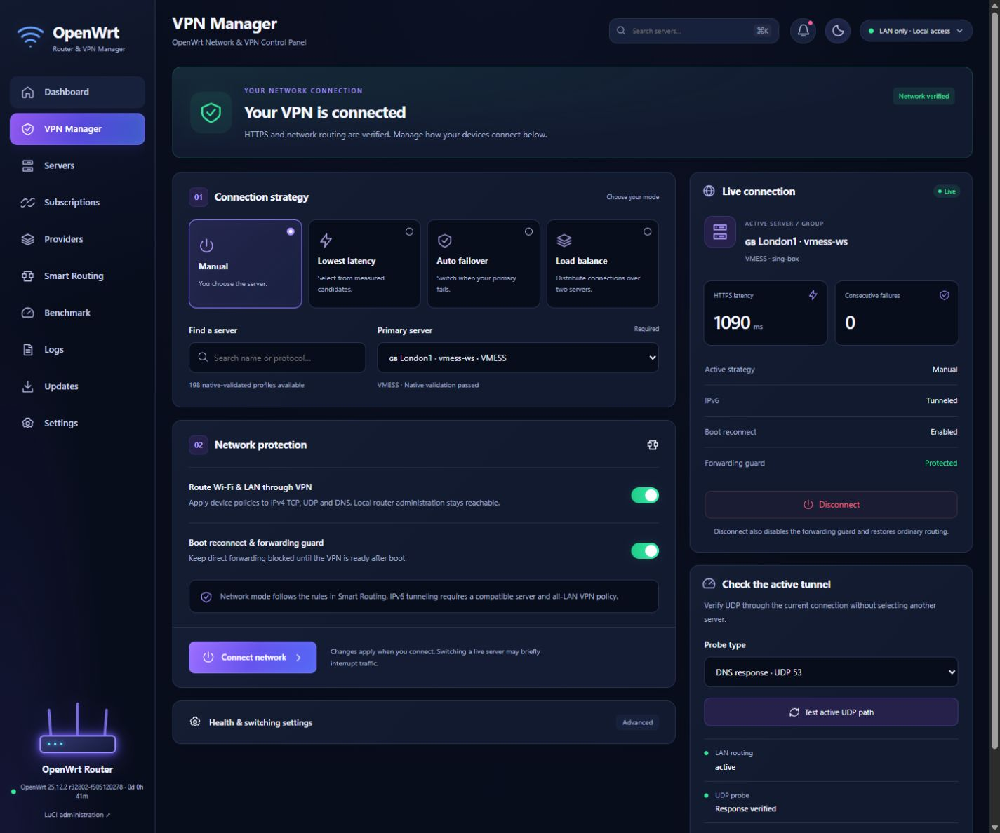

<div align="center">

# 🌊 Gale Control

### A modern OpenWrt VPN workspace

**A lightweight dashboard. Real connection checks. Recoverable changes.**


[🚀 Install](#-easy-guided-install) · [✨ Features](#-why-gale) · [🔌 Protocols](#-protocols--verification) · [📚 Full guide](docs/public/installation.md) · [فارسی](README.fa.md)

</div>




> **Early community release:** tested on Google WiFi ARMv7 / OpenWrt 25.12.2.
> The current installer requires `arm_cortex-a7_neon-vfpv4`, fw4/nftables,
> `br-lan` and LAN `192.168.10.1/24`. Other layouts/architectures are not yet
> supported by the guided installer. It never changes your LAN to force a match.

## ✨ Why Gale?

- **📱 An app-style interface:** an English, LTR dashboard with dark/light themes,
  responsive server cards, a mobile glass dock, clear forms and live status.
- **📊 Measured, not simulated:** real CPU, RAM, WAN counters, connection history
  and redacted events. Unknown measurements are shown as unknown.
- **🧭 Independent connection strategies:** manual selection, lowest measured
  HTTPS latency, automatic failover and two-server connection balancing.
- **🔗 One subscription library:** custom User-Agent, scheduled refresh, URI/Base64,
  Clash YAML/JSON, native core outbounds, WireGuard and OpenVPN import.
- **🔎 Discovery with a pipeline:** extract, normalize, deduplicate, validate and
  probe profiles from approved subscriptions, link indexes and JSON catalogs.
- **🛡️ Recoverable network operations:** forwarding protection, local management
  exceptions, explicit policy application and independent recovery helpers.
- **📦 Core management:** official Xray/sing-box downloads, SHA-256 verification,
  version staging, activation and connection-checked upgrade rollback.
- **💾 Practical recovery:** signed full Gale backups, preview, on-device snapshot,
  client confirmation and rollback. Code releases use immutable checksummed directories.
- **🪶 Built for the router:** ucode/ubus backend, static Preact frontend, SVG charts
  and icons; no Node.js server, chart framework or animation runtime on the router.

Gale keeps LuCI and SSH available. Installing the panel does **not** activate VPN
routing, reboot the router or flash firmware.

## 🚀 Easy guided install

On a computer with **Node 22.12+, npm, Git, OpenSSH and tar**, after configuring
working noninteractive root SSH authentication:

```sh
git clone https://github.com/its-hesam/gale-control.git
cd gale-control
npm ci
npm run install:router -- --host root@192.168.10.1 --install-deps
```

Then open **http://192.168.10.1/gale/** and use your existing OpenWrt root account.

🔍 Prefer a read-only compatibility check first?

```sh
npm run check:router -- --host root@192.168.10.1
```

The installer checks the platform, LAN, modules, tools and free space, builds on
your computer, publishes a versioned release and verifies that six standard
OpenWrt configuration files stay unchanged. `--install-deps` installs prerequisites
from the router's configured official `apk` feeds; omit it if dependencies already
exist. There is no `curl | sh` shortcut and no bundled private configuration.

**After installation:** download the required managed cores in **Updates**, import
your own subscription, validate/test a server, and connect explicitly in **VPN Manager**.
The [complete installation guide](docs/public/installation.md) covers prerequisites,
managed versions, first connection, updates, recovery and troubleshooting.

**Installation evidence:** installer preflight, a guided in-place update, and versioned recovery are
verified on the test device. A separate factory-reset/clean-install acceptance run
has not yet been performed. This is a guided supported-setup install, not a promise
of universal one-click installation on every OpenWrt router.

## 🔌 Protocols & verification

Gale deliberately separates **implemented/native-validated** from **real traffic tested**.

| Protocol / format | Core path | Current evidence |
|---|---|---|
| VLESS TCP/TLS | Xray / sing-box adapter | Real provider HTTPS and LAN routing |
| VLESS XHTTP/TLS | Xray; separate compatibility executable where required | Real provider HTTPS and controlled TLS transport tests |
| VLESS XHTTP/REALITY | Xray | Native schema fixture; exact provider combination not handshake-verified |
| VMess WS/TLS | Xray / sing-box adapter | Real HTTPS, IPv4/IPv6 LAN, failover and balancing acceptance |
| gRPC transport | Xray compatibility path where required | Controlled VMess roundtrip, including self-signed TLS fixture |
| WireGuard | sing-box userspace endpoint | Real single-peer provider HTTPS/UDP; two encrypted fixture peers with handshakes and payloads |
| OpenVPN | sing-box 1.14.4 userspace endpoint | Adapter/native configuration implemented; provider acceptance not completed |
| Trojan / Shadowsocks | Xray / sing-box | Native validation; no blanket provider acceptance claim |
| Hysteria2 / TUIC / AnyTLS | sing-box | Native schema fixtures; provider handshake not verified |
| SOCKS / HTTP / HTTPS | Core adapters | Controlled HTTP-over-SOCKS chain traffic; HTTPS adapter has no general provider claim |
| Native JSON detour chains | Same-core sing-box / Xray | Bounded graph validation, roundtrip and controlled two-hop traffic |
| Clash `dialer-proxy` | Named same-core nodes | Import, cycle rejection, native validation and controlled two-hop traffic |

Tested managed versions: **Xray 26.9.30**, **sing-box 1.14.4**, plus separate
**Xray 25.12.8** for compatibility. Advanced features may require these exact
managed versions. No core executables are redistributed in this repository.

WireGuard supports up to 16 peers in the adapter; two peers have encrypted data
acceptance. Ordered DNS failover was tested with a silent primary and working
secondary. These results do not prove that every peer/provider/option works.

## 🧠 Routing, automation and visibility

| Capability | Behavior |
|---|---|
| Manual | Choose a native-validated profile and confirm connectivity |
| Automatic best | Choose by fresh measured HTTPS latency with hysteresis |
| Failover | Switch after confirmed failures and a minimum hold period |
| Load balancing | Distribute separate connections over two members; not bandwidth bonding |
| Device policies | IPv4 VPN/direct/block exceptions by device IP |
| IPv6 | Tested TCP/TLS, non-DNS UDP/NTP and DNS; requires compatible provider and all-LAN VPN |
| Forwarding guard | Block direct client forwarding while protected VPN is unavailable |
| Monitoring | Bounded RAM history, live events and redacted diagnostics |

## 🆚 Gale and PassWall

Gale is an alternative workflow, not a claim that PassWall is slow or lacks features.
[PassWall](https://github.com/Openwrt-Passwall/openwrt-passwall) and
[PassWall2](https://github.com/Openwrt-Passwall/openwrt-passwall2) are established
LuCI proxy applications with their own package ecosystem.

| Consideration | Gale | PassWall / PassWall2 |
|---|---|---|
| Interface | Standalone app-style Preact workspace, mobile dock, dark/light themes | Integrated LuCI application |
| Getting started | Guided source installer with strict preflight for the documented setup | Upstream packages / OpenWrt feeds; PassWall2 documents `.ipk` and `.apk` packages |
| Core engines | Managed Xray and sing-box, version-specific adapters | Upstream package ecosystem includes multiple proxy engines |
| Scope today | Small explicitly documented hardware/LAN validation scope | Broader established OpenWrt packaging ecosystem |
| Gale's emphasis | Measured UI state, clear test scope, versioned code recovery and full Gale restore workflow | Consult upstream documentation for its current feature/recovery behavior |

**Choose Gale for its focused dashboard experience and explicit, inspectable recovery
workflows.** No comparative speed, memory, reliability or security superiority is
claimed: there has been no controlled head-to-head benchmark.

## 🧪 What has actually been tested?

- Real all-LAN HTTPS, DNS and UDP interception, plus a compatible IPv6 provider.
- Best selection, controlled failover and a bounded 12-request balancing test.
- Injected core activation failure and automatic return to the previous core/catalog.
- Reboot during an uncommitted application release and corrupt-manifest fallback.
- Full Gale recovery after controlled catalog/system-file changes, with working
  client HTTPS, SSH and authenticated LuCI afterward.
- A real Wi-Fi client's VPN/direct/block exceptions and additional isolated policies.
- Two-peer encrypted WireGuard and ordered DNS resolver fallback.
- Native/core fixtures, frontend unit tests and responsive browser checks.

Local device reports and private screenshots are not published. These are bounded
acceptance results, not a multi-day soak or a guarantee for other hardware.

## ⚠️ Current boundaries

- Different architectures/LAN layouts, mixed-core chains, dynamic imported Clash
  groups and arbitrary proprietary fields are not advertised as supported.
- Public IP measurement, general packet-loss measurement and new multi-metric
  Best Overall/Stability scoring have no complete API; the UI labels them accordingly.
- IPv6 provider capability must be verified; a WireGuard IPv6 address alone proves nothing.
- Physical power-cut acceptance, firmware/eMMC restoration and multi-day load tests
  have not been completed. Application recovery is not a bootable firmware image.
- Core archive SHA-256 is checked; independent publisher signatures are not verified.
- Only one transparent routing manager should be active at a time. Gale does not
  uninstall competing applications or silently take over their rules.

## 🛠️ Development

```sh
npm ci
npm test
npm run build
npm run dev
```

The development server proxies `/ubus` to the local test router; do not expose it
to untrusted clients. Build output is static under `dist/`. Router code is in
`router/`, the frontend in `src/`, and deployment/acceptance tooling in `scripts/`.
Hardware acceptance tools are for a prepared test network; they are not CI or
routine installation steps. Some older tools use fixed test-router defaults.

## 🔐 Privacy & recovery

Fresh installations contain no provider links or private keys. Credentials live
on the router; browser session tokens stay in memory. Theme, motion preferences,
favorites and recent IDs are local browser preferences.

Recovery bundles are signed **but not encrypted**. They can include network settings
and SSH identity. Keep the signing key separately; never commit backups or raw
configurations. Read [SECURITY.md](SECURITY.md) before sharing diagnostic files.

## 📄 License & credits

Gale's original source is released under the [MIT License](LICENSE). OpenWrt, ucode,
Preact, Xray, sing-box, Lua/lyaml and other external dependencies retain their own
licenses. Gale does not bundle or relicense their executables. Thanks to the
OpenWrt and proxy-core communities that make this project possible.
